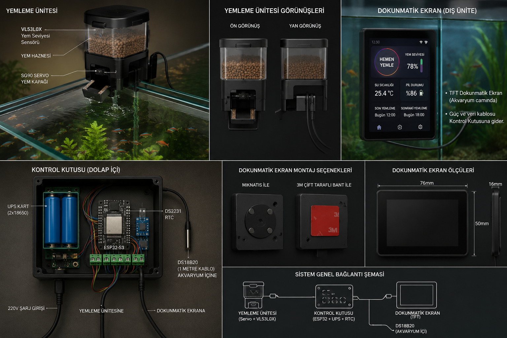

<p align="center">
  
</p>

<h1 align="center">Balık Yemleyici By Orçun KUTLU</h1>

ESPHome ile hazırlanmış, dokunmatik ekranlı ve Home Assistant uyumlu otomatik balık yemleyici projesi.

Proje iki ESP32 cihazdan oluşur:

- **Ana kontrol ünitesi**: ESP32-S3 üzerinde LVGL arayüz, TFT dokunmatik ekran, saat, sıcaklık, pil/şebeke takibi ve yemleme planlarını yönetir.
- **Servo modülü**: ESP32-CAM üzerinde servo motoru ve VL53L0X yem seviyesi sensörünü yönetir. Ana ünite ile ESP-NOW üzerinden haberleşir.



## Özellikler

- 2.4" 240x320 ILI9341 TFT ekran ve XPT2046 dokunmatik kontrol.
- LVGL tabanlı yerel ekran arayüzü.
- Günde 3 ayrı yemleme planı.
- Manuel yemleme başlatma.
- Servo açıklık yüzdesi ayarı.
- ESP-NOW ile ana cihaz/servo modülü haberleşmesi.
- VL53L0X ile yem seviyesi ölçümü.
- DS3231 RTC desteği ve NTP senkronizasyonu.
- İnternet yokken RTC üzerinden zaman takibi.
- DS18B20 su sıcaklığı ölçümü.
- Pil voltajı, pil yüzdesi ve şebeke gücü takibi.
- Wi-Fi, web arayüzü, OTA ve Home Assistant API desteği.
- RGB LED durum bildirimleri.

## Dosya Yapısı

```text
.
├── balik-yemleyici-by-orcun.yaml   # Ana ESP32-S3 kontrol ünitesi
├── balik-yemleyici-servo.yaml      # ESP32-CAM servo/yem seviyesi modülü
├── components/ds3231/              # Yerel DS3231 ESPHome bileşeni
├── fonts/                          # Ekranda kullanılan fontlar
├── resimler/                       # Logo ve sistem şeması
└── secrets.yaml                    # Wi-Fi, IP ve MAC bilgileri
```

## Donanım

### Ana Kontrol Ünitesi

| Parça | Açıklama |
| --- | --- |
| ESP32-S3-DevKitC-1-N16R8 | 16 MB flash, 8 MB PSRAM |
| ILI9341 TFT ekran | 240x320 SPI ekran |
| XPT2046 touch controller | Dokunmatik giriş |
| DS3231 RTC | Yedek gerçek zaman saati |
| DS18B20 | Su sıcaklığı sensörü |
| WS2812 RGB LED | Durum bildirim LED'i |
| Pil voltaj bölücü | ADC ile pil ölçümü |
| Şebeke algılama girişi | Adaptör/pil modu takibi |

### Servo Modülü

| Parça | Açıklama |
| --- | --- |
| ESP32-CAM AI Thinker | Servo modülü kontrol kartı |
| Servo motor | Yem kapağını açıp kapatır |
| VL53L0X | Yem haznesi seviye ölçümü |
| Flash LED | Yemleme sırasında durum ışığı |

## Pin Bağlantıları

### Ana Kontrol Ünitesi

| İşlev | Pin |
| --- | --- |
| TFT SPI CLK | GPIO12 |
| TFT SPI MOSI | GPIO11 |
| TFT SPI MISO | GPIO13 |
| TFT CS | GPIO10 |
| TFT DC | GPIO9 |
| TFT RESET | GPIO14 |
| TFT arka ışık | GPIO6 |
| Touch CS | GPIO15 |
| Touch interrupt | GPIO16 |
| I2C SDA | GPIO8 |
| I2C SCL | GPIO17 |
| DS18B20 OneWire | GPIO4 |
| Pil voltaj ADC | GPIO2 |
| Şebeke gücü girişi | GPIO7 |
| RGB LED | GPIO48 |

### Servo Modülü

| İşlev | Pin |
| --- | --- |
| I2C SDA | GPIO13 |
| I2C SCL | GPIO14 |
| Servo PWM | GPIO16 |
| Flash LED | GPIO4 |

## ESP-NOW Komutları

Ana cihaz ve servo modülü aynı ESP-NOW kanalında çalışır.

| Komut | Yön | Açıklama |
| --- | --- | --- |
| `0x01` | Ana cihaz -> Servo | Yemleme komutu |
| `0x02` | Ana cihaz -> Servo | Servo açısı ayarı |
| `0x03` | Ana cihaz -> Servo | Durum/yem seviyesi sorgusu |
| `0x03` | Servo -> Ana cihaz | Yem seviyesi yüzdesi |
| `0x10` | Servo -> Ana cihaz | Servo modülü çevrimiçi bildirimi |

## Kurulum

1. ESPHome kurulu değilse kurun:

   ```bash
   pip install esphome
   ```

2. `secrets.yaml` dosyasını kendi ağınıza ve cihaz MAC adreslerinize göre düzenleyin:

   ```yaml
   wifi_ssid: "WiFi_Adi"
   wifi_password: "WiFi_Sifresi"
   wifi_static_ip: "11.11.11.161"
   wifi_gateway: "11.11.11.1"
   wifi_subnet: "255.255.255.0"
   servo_mac_address: AA:BB:CC:DD:EE:FF
   servo_static_ip: "11.11.11.169"
   baliktank_mac_address: 11:22:33:44:55:66
   ```

3. Ana kontrol ünitesini derleyip yükleyin:

   ```bash
   esphome run balik-yemleyici-by-orcun.yaml
   ```

4. Servo modülünü derleyip yükleyin:

   ```bash
   esphome run balik-yemleyici-servo.yaml
   ```

İlk kurulumdan sonra OTA ile güncelleme yapılabilir.

## Home Assistant Varlıkları

Ana cihaz Home Assistant tarafında aşağıdaki kontrolleri ve sensörleri yayınlar:

- **Yemlemeyi Başlat**: Manuel yemleme komutu gönderir.
- **Cihaz Durumunu Sorgula**: Servo modülünden durum/yem seviyesi ister.
- **Yemleyici Servo Açısı**: Servo açıklık değerini ayarlar.
- **Yemleme 1/2/3 Aktif**: Günlük planları açar veya kapatır.
- **Yemleme 1/2/3**: Plan saatlerini belirler.
- **Ekran Bekleme Süresi** ve **Ekran Parlaklığı**: Yerel ekran davranışını ayarlar.
- **Water Temperature**: DS18B20 su sıcaklığı.
- **Yem Seviyesi**: Servo modülünden gelen yem seviyesi.
- **Pil Voltajı** ve **Pil Yüzdesi**: Batarya durumu.
- **Şebeke Gücü**: Adaptör gücü var/yok bilgisi.
- **Sonraki Yemleme** ve **Yemleme Döngüsü**: Plan özeti.
- **WiFi Sinyal**, **IP Adresi** ve **Uptime**: Tanılama bilgileri.

## Çalışma Mantığı

Ana cihaz her saniye aktif yemleme planlarını kontrol eder. Saat kaynağı olarak önce NTP kullanılır; internet saati geçerli değilse DS3231 RTC devreye girer. Plan saati geldiğinde ana cihaz ESP-NOW ile servo modülüne `0x01` yemleme komutu gönderir.

Servo modülü komutu alınca kapağı açar, kısa bir silkelenme hareketi yapar ve servo enerjisini keser. VL53L0X sensöründen gelen yem seviyesi düzenli olarak ana cihaza gönderilir ve ekranda/Home Assistant'ta gösterilir.

## Hobi Projesi Olarak Yapım Rehberi

Bu proje bir hobi projesidir. Üretim amaçlı değil; ESPHome, elektronik, mekanik ve yazılımın birlikte çalıştığı, kullanıcı tarafından test edilip geliştirilmesi hedeflenen bir deneysel yapıdır. Bu nedenle, montaj sırasında sabır, dikkatli kablolama ve küçük test adımları önemlidir.

### 1. Gerekli Malzemeler

- 1 adet ESP32-S3 tabanlı ana kontrol kartı
- 1 adet 2.8" ILI9341 TFT ekran
- 1 adet XPT2046 dokunmatik kontrolcü
- 1 adet DS3231 RTC modülü
- 1 adet DS18B20 su sıcaklığı sensörü
- 1 adet WS2812 RGB LED
- 1 adet ESP32-CAM AI-Thinker tabanlı servo modülü
- 1 adet servo motor
- 1 adet VL53L0X mesafe sensörü
- Jumper kablolar, breadboard veya kurutulmuş bağlantı noktaları
- Güç kaynağı ve gerekirse ayrı servo beslemesi
- Kasa / montaj parçası, vida ve mekanik destek

> Servo motoru için ayrı 5 V besleme ve ortak toprak bağlantısı kullanın.

### 2. Pin Bağlantıları

#### Ana Kontrol Ünitesi

| İşlev | Pin |
| --- | --- |
| TFT SPI CLK | GPIO12 |
| TFT SPI MOSI | GPIO11 |
| TFT SPI MISO | GPIO13 |
| TFT CS | GPIO10 |
| TFT DC | GPIO9 |
| TFT RESET | GPIO14 |
| TFT LED | GPIO6 |
| Touch CS | GPIO15 |
| Touch IRQ | GPIO16 |
| I2C SDA | GPIO8 |
| I2C SCL | GPIO17 |
| DS18B20 OneWire | GPIO4 |
| Pil Voltaj ADC | GPIO5 |
| Şebeke Gücü Girişi | GPIO7 |
| RGB LED | GPIO48 |

#### Servo Modülü

| İşlev | Pin |
| --- | --- |
| I2C SDA | GPIO13 |
| I2C SCL | GPIO14 |
| Servo PWM | GPIO16 |
| Flash LED | GPIO4 |
| VL53L0X sensör gücü/temel bağlantıları | 3.3 V / GND |

### 3. Yapım Aşamaları

1. İlk olarak ana kontrol kartını ve servo modülünü ayrı ayrı test edin.
2. Ekran, dokunmatik ve I2C cihazları tek tek çalıştırıp doğrulayın.
3. RTC ve sıcaklık sensörünü bağlayıp saat ve sıcaklık değerlerinin okunmasını kontrol edin.
4. Servo motoru ve VL53L0X sensörünü bağlayıp yemleme hareketini ve seviye ölçümünü test edin.
5. ESP-NOW haberleşmesini kurup ana cihaz ile servo modülünün birbirini tanımasını sağlayın.
6. Tüm parçaları tek bir mekanik düzeneğe monte edin; servo kolu ve kapak mekanizması düzgün çalışmalı.
7. Son olarak yazılım ayarlarını yapıp yemleme planlarını, servo açıklığını ve ekran ayarlarını test edin.

### 4. İlk Açılış ve Kalibrasyon

- `secrets.yaml` dosyasını kendi ağ bilgilerinize ve MAC adreslerinize göre güncelleyin.
- Her iki ESPHome YAML dosyasını da derleyip yükleyin.
- İlk açılışta Wi-Fi bağlantısını ve ESP-NOW iletişimini kontrol edin.
- Servo açıklık yüzdesini ve yemleme hareketini test ederek kapak açma/kapama süresini ayarlayın.
- Yem seviyesi sensörünü gerçek hazne seviyesine göre kalibre edin.

### 5. Dikkat Edilmesi Gerekenler

- ESP-NOW için iki cihazın MAC adresleri doğru yazılmalıdır.
- Ana cihazdaki ESP-NOW kanalı `2` olarak ayarlanmış olup servo modülü de aynı kanalda çalışmalıdır.
- Ana cihaz Wi-Fi bağlantısı kuramazsa `Balik Yemleyici WiFi` adlı fallback erişim noktası açılır.
- DS3231 yerel bileşeni `components/ds3231` klasöründen yüklenir.
- Pil yüzdesi 4.2 V tam dolu, 3.3 V boş kabul edilerek hesaplanır.
- Bu sistem bir hobi projesi olarak tasarlanmıştır; uzun süreli ve kritik uygulamalarda güvenlik ve bakım kontrolleri eklenmelidir.
- Herhangi bir güç değişimi sonrası yeniden başlatma ve sensör doğrulama yapılmalıdır.

## Notlar

- ESP-NOW için iki cihazın MAC adresleri `secrets.yaml` içinde doğru olmalıdır.
- Ana cihazdaki ESP-NOW kanalı `2` olarak ayarlanmıştır; servo modülü de aynı kanalda çalışır.
- Ana cihaz Wi-Fi bağlantısı kuramazsa `Balik Yemleyici WiFi` adlı fallback erişim noktası açar.
- DS3231 yerel bileşeni `components/ds3231` klasöründen yüklenir.
- Pil yüzdesi 4.2 V tam dolu, 3.3 V boş kabul edilerek hesaplanır.
